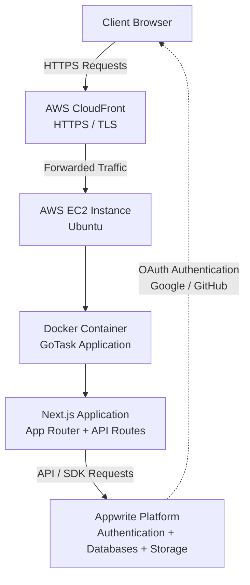

 <div align="center">

# GoTask

### Full-Stack Project & Task Management Platform

**Organize projects. Manage teams. Track progress. Deliver work efficiently.**

[](https://d6wed9xlhqd2u.cloudfront.net/sign-in)
[](https://github.com/Sai-Likitha-Madisetty/jira-clone-GoTask)


</div>

---

## Overview

**GoTask** is a full-stack project and task management platform inspired by Jira, designed to help teams organize projects, manage workspaces, collaborate with members, and track task progress through an intuitive interface.

The application provides workspace-based project management with multiple task visualization options, including Kanban boards, tables, and calendar views. It also supports team invitations, role management, OAuth authentication, and persistent storage.

Built using **Next.js, React, TypeScript, Tailwind CSS, and Appwrite**, GoTask combines a modern frontend with server-side API routes and managed backend services.

The application is containerized using Docker, hosted on **AWS EC2**, and delivered over HTTPS through **AWS CloudFront**.

---

## Key Features

- **Workspace Management:** Create, update, switch between, and delete workspaces with customizable settings and invitation codes.
- **Project Organization:** Organize projects within workspaces, manage project details, and customize project avatars.
- **Task Management:** Create, update, filter, and organize tasks with structured project workflows.
- **Multiple Task Views:** Visualize and manage tasks using interactive Kanban boards, table views, and calendar views.
- **Team Collaboration:** Invite members through shareable invitation links and manage workspace participants.
- **Role Management:** View workspace members and manage their assigned roles.
- **OAuth Authentication:** Secure sign-in and session management through Google and GitHub OAuth providers.
- **File & Image Storage:** Store and retrieve workspace and project media using Appwrite Storage.
- **Project Analytics:** Access project-related analytics and monitor work organization.
- **Responsive Interface:** Modern, responsive user interface designed for efficient project and task management.
- **Cloud Deployment:** Docker-based deployment on AWS EC2 with HTTPS delivery through AWS CloudFront.

---

## Tech Stack

### Frontend & Application

| Technology | Purpose |
| :--- | :--- |
| **Next.js** | Full-stack React framework with App Router |
| **React** | Component-based user interface development |
| **TypeScript** | Type-safe application development |
| **Tailwind CSS** | Responsive UI styling and layout |
| **React Query** | Server-state management, data fetching, caching, and mutations |

### Backend, Authentication & Storage

| Technology | Purpose |
| :--- | :--- |
| **Appwrite** | Backend services, authentication, databases, and storage |
| **Next.js API Routes** | Server-side API endpoints and application logic |
| **Google OAuth** | Google-based authentication |
| **GitHub OAuth** | GitHub-based authentication |
| **Appwrite Databases** | Persistent storage for workspaces, members, projects, and tasks |
| **Appwrite Storage** | File and image management |

### DevOps & Cloud Infrastructure

| Technology | Purpose |
| :--- | :--- |
| **Docker** | Application containerization |
| **AWS EC2** | Cloud compute infrastructure hosting the application |
| **AWS CloudFront** | HTTPS delivery and content distribution |
| **Ubuntu** | Cloud server operating system |
| **Git** | Version control |
| **GitHub** | Source code hosting and repository management |

---

## System Architecture

GoTask follows a full-stack application architecture that combines a Next.js application, Appwrite backend services, and AWS cloud infrastructure.



### Architecture Components

**1. Client Application**

The frontend provides the user interface for authentication, workspace management, project organization, task tracking, and team collaboration.

React components and Next.js App Router organize the application's pages and interactive features.

**2. Application & API Layer**

Next.js handles application routing, server-side functionality, and backend API operations.

Core responsibilities include:

- Workspace and project operations.
- Task creation and management.
- Member invitations and role management.
- Authentication and OAuth callback handling.
- Communication with Appwrite services.

**3. Appwrite Backend Services**

Appwrite provides the application's managed backend infrastructure:

- User authentication and session management.
- Google and GitHub OAuth integration.
- Database collections for workspaces, members, projects, and tasks.
- Storage buckets for project and workspace images.

**4. Cloud & Deployment Infrastructure**

The application is containerized using Docker and hosted on an AWS EC2 instance running Ubuntu.

AWS CloudFront provides HTTPS delivery and forwards application traffic to the EC2-hosted application.

---

## Project Structure

```text
jira-clone-GoTask/
│
├── public/
│
├── src/
│   ├── app/
│   │   ├── (auth)/
│   │   ├── (dashboard)/
│   │   ├── (standalone)/
│   │   ├── api/
│   │   └── oauth/
│   │
│   ├── components/
│   │
│   ├── features/
│   │   ├── auth/
│   │   ├── members/
│   │   ├── projects/
│   │   ├── tasks/
│   │   └── workspaces/
│   │
│   ├── hooks/
│   ├── lib/
│   └── config.ts
│
├── .dockerignore
├── .env.example
├── .gitignore
├── Dockerfile
├── next.config.mjs
├── package.json
├── tailwind.config.ts
└── tsconfig.json
```

---

## Getting Started

Follow these instructions to run GoTask locally.

### Prerequisites

Ensure the following tools and services are available:

- Node.js (v20 or higher recommended)
- npm
- Git
- An Appwrite project
- Configured Appwrite database collections and storage bucket
- Google and GitHub OAuth credentials (if using OAuth authentication)

### 1. Clone the Repository

```bash
git clone https://github.com/Sai-Likitha-Madisetty/jira-clone-GoTask.git

cd jira-clone-GoTask
```

### 2. Install Dependencies

```bash
npm install
```

### 3. Configure Environment Variables

Create a `.env` file using the provided example:

```bash
cp .env.example .env
```

Configure the following application variables:

```env
NEXT_PUBLIC_APP_URL=http://localhost:3000

NEXT_PUBLIC_APPWRITE_ENDPOINT=https://cloud.appwrite.io/v1

NEXT_PUBLIC_APPWRITE_PROJECT=your_project_id

NEXT_PUBLIC_APPWRITE_DATABASE_ID=your_database_id

NEXT_PUBLIC_APPWRITE_WORKSPACES_ID=your_workspaces_collection_id

NEXT_PUBLIC_APPWRITE_MEMBERS_ID=your_members_collection_id

NEXT_PUBLIC_APPWRITE_PROJECTS_ID=your_projects_collection_id

NEXT_PUBLIC_APPWRITE_TASKS_ID=your_tasks_collection_id

NEXT_PUBLIC_APPWRITE_IMAGES_BUCKET_ID=your_images_bucket_id
```

Replace the placeholder values with the corresponding identifiers from your Appwrite project.

**Important:** Never commit `.env` files, private credentials, or sensitive configuration values to GitHub.

Keep `.env` excluded through `.gitignore`.

### 4. Start the Development Server

```bash
npm run dev
```

Open the application in your browser:

```text
http://localhost:3000
```

---

## Production Deployment (Docker + AWS EC2 + CloudFront)

GoTask is deployed using a containerized production setup on **AWS EC2**, with **AWS CloudFront** providing HTTPS delivery.

### Live Application

[https://d6wed9xlhqd2u.cloudfront.net/sign-in](https://d6wed9xlhqd2u.cloudfront.net/sign-in)

### Deployment Architecture

The production deployment follows these steps:

1. The Next.js application is prepared for production.
2. Docker builds the application into a container image.
3. The container is deployed on an AWS EC2 instance running Ubuntu.
4. The application runs inside the container and listens on port `3000`.
5. AWS CloudFront forwards incoming HTTPS requests to the EC2-hosted application.
6. Appwrite provides authentication, database operations, and storage services.

### Build & Run with Docker

Pass the required public application configuration as build arguments when building the Docker image:

```bash
docker build \
  --build-arg NEXT_PUBLIC_APP_URL="$NEXT_PUBLIC_APP_URL" \
  --build-arg NEXT_PUBLIC_APPWRITE_ENDPOINT="$NEXT_PUBLIC_APPWRITE_ENDPOINT" \
  --build-arg NEXT_PUBLIC_APPWRITE_PROJECT="$NEXT_PUBLIC_APPWRITE_PROJECT" \
  --build-arg NEXT_PUBLIC_APPWRITE_DATABASE_ID="$NEXT_PUBLIC_APPWRITE_DATABASE_ID" \
  --build-arg NEXT_PUBLIC_APPWRITE_WORKSPACES_ID="$NEXT_PUBLIC_APPWRITE_WORKSPACES_ID" \
  --build-arg NEXT_PUBLIC_APPWRITE_MEMBERS_ID="$NEXT_PUBLIC_APPWRITE_MEMBERS_ID" \
  --build-arg NEXT_PUBLIC_APPWRITE_PROJECTS_ID="$NEXT_PUBLIC_APPWRITE_PROJECTS_ID" \
  --build-arg NEXT_PUBLIC_APPWRITE_TASKS_ID="$NEXT_PUBLIC_APPWRITE_TASKS_ID" \
  --build-arg NEXT_PUBLIC_APPWRITE_IMAGES_BUCKET_ID="$NEXT_PUBLIC_APPWRITE_IMAGES_BUCKET_ID" \
  -t gotask-jira-clone:local .
```

Run the container:

```bash
docker run -d \
  --name gotask \
  --restart unless-stopped \
  -p 3000:3000 \
  --env-file .env \
  gotask-jira-clone:local
```

### Deployment Configuration

- **AWS EC2:** Hosts the Dockerized Next.js application.
- **AWS CloudFront:** Provides HTTPS access through the CloudFront distribution.
- **Appwrite Web Platform:** Register the production CloudFront hostname in Appwrite's allowed web platforms for browser access and OAuth redirects.
- **Environment Variables:** Configure the required application and Appwrite identifiers during deployment.
- **Docker:** Provides a consistent application runtime environment.

**Security Note:** Public `NEXT_PUBLIC_*` variables are exposed to the browser. Never include private API keys, server secrets, or privileged credentials in these variables.

---

## Security & Reliability

GoTask integrates managed authentication and backend services to support secure application access and data management.

Key considerations include:

- **OAuth Authentication:** Google and GitHub sign-in integration through Appwrite.
- **Session Management:** Appwrite-managed authentication sessions.
- **Workspace Access:** Workspace-based member and role management.
- **Data Persistence:** Appwrite database collections maintain application records.
- **Media Storage:** Appwrite Storage manages workspace and project images.
- **Environment Configuration:** Application configuration is managed through environment variables.
- **Container Isolation:** Docker packages the application into an isolated runtime environment.
- **HTTPS Delivery:** AWS CloudFront provides encrypted access to the deployed application.

---

## Future Enhancements

Potential areas for further development include:

- Sprint planning and sprint progress tracking.
- Task priorities, labels, and advanced filtering.
- Task comments and activity history.
- Real-time team notifications.
- File attachments and document sharing.
- Granular role-based access control.
- Advanced project analytics and reporting.
- Automated CI/CD workflows for cloud deployments.
- AI-powered task descriptions, summaries, and project assistance.

---

<div align="center">

### Built for teams. Designed for productivity.

If **GoTask** caught your attention, consider giving this repository a star.

Every star helps this project reach more developers.


</div>
